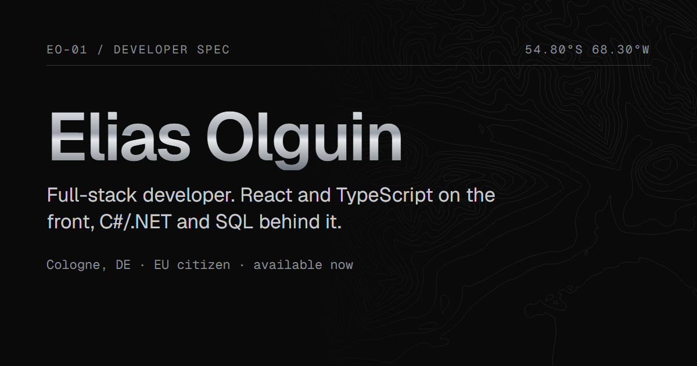

# Elias Olguin · Portfolio

**Live: [www.eliasolguin.dev](https://www.eliasolguin.dev)**

[](https://www.eliasolguin.dev)

One-page portfolio of a full-stack developer (React, TypeScript, C#/.NET, SQL). It reads like an engineering spec sheet in black and steel, and the page itself is a trip along the meridian from Ushuaia, where I started on a factory line, to Cologne, where I live now. English, Spanish and German.

## What is on the page

- **Hero:** role, the factory-to-software story, stack table, location, availability and the CV in the visitor's language.
- **At a glance:** role, system scope and personal progression, kept to facts that can be checked.
- **Experience (Newsan):** each system as problem, contribution and operational benefit.
- **Projects:** DoneToday and recycle-app. Each card has key technical decisions, a "How it works" disclosure and a gallery (DoneToday's 9 walkthrough slides in each language).
- **Path:** welder → repair technician → software developer → move to Germany, plus the context since 2024.
- **Education, languages and contact.**

## Built with

React 19 · TypeScript · Vite · plain CSS with design tokens · Vitest + Testing Library · oxlint · Prettier · Playwright (tooling only). Deployed on Vercel.

No UI framework, no router and no i18n library: the copy lives in typed files and a missing translation fails the typecheck.

## Details worth a look

| Area          | How                                                                                                                                                                                                               |
| ------------- | ----------------------------------------------------------------------------------------------------------------------------------------------------------------------------------------------------------------- |
| Languages     | `src/content/{en,es,de}.ts` share one `Content` type. The language comes from a saved choice, then the browser, then English (`src/i18n.ts`). `<html lang>` follows the switcher.                                 |
| Section menu  | `useActiveSection` marks the section in view with two `IntersectionObserver`s (a middle band, plus "last section fully visible" for short endings). A menu click keeps its section marked while the page scrolls. |
| Route line    | `RouteLine` maps scroll progress to a latitude from 54.8°S (Ushuaia) to 50.9°N (Köln), updated at most once per frame.                                                                                            |
| Contours      | `src/assets/ushuaia-contours.svg` is generated from real elevation data (AWS Terrain Tiles) by `tools/contours/generate.mjs`.                                                                                     |
| Gallery       | `ShotZoom` uses a native `<dialog>`: named, closes with Escape, moves focus to Close and back, arrow keys and a counter, only the current image loaded.                                                           |
| Accessibility | Landmarks, skip link, visible focus, `aria-current` in the menu, AA contrast on every text colour, and `prefers-reduced-motion` respected (no sheen, no smooth scroll, clips do not autoplay).                    |
| Privacy       | No phone number anywhere (a test scans every language and the rendered page), no cookies, no analytics, no third-party requests.                                                                                  |

## Run it

Requirements: Node.js 24.

```bash
npm install
npm run dev
```

| Script              | Does                                      |
| ------------------- | ----------------------------------------- |
| `npm run dev`       | Development server                        |
| `npm test`          | Vitest suite                              |
| `npm run typecheck` | TypeScript, no emit                       |
| `npm run lint`      | oxlint                                    |
| `npm run build`     | Typecheck and production build in `dist/` |
| `npm run preview`   | Serve the production build                |
| `npm run format`    | Prettier                                  |

CI (`.github/workflows/ci.yml`) runs `npm audit`, lint, typecheck, tests and build on every push, with a read-only token.

## Project structure

```
src/
  content/       typed copy per language (en, es, de)
  sections/      Hero, Metrics, Experience, Projects, Path, Education, Contact
  components/    Header, SectionNav, LangSwitcher, RouteLine, ShotZoom, LoopVideo, …
  styles/        tokens.css (colours, fonts, spacing) and global.css
  links.ts       URLs, stack names and media lists (not translated)
public/          CVs, media, OG image, favicon, robots.txt
tools/           generators and QA scripts (below)
vercel.json      security headers
```

## Tools

| Command                                                          | Output                                                              |
| ---------------------------------------------------------------- | ------------------------------------------------------------------- |
| `node tools/contours/generate.mjs`                               | Ushuaia contour SVG from elevation tiles                            |
| `node tools/media/donetoday-gallery.mjs <DoneToday/entregables>` | DoneToday slides (EN/ES/DE) and card images in `public/media/`      |
| `node tools/og/render.mjs`                                       | `public/og.png`, the link-preview image                             |
| `node tools/qa/csp.mjs`                                          | Loads the build under the production CSP and fails on any violation |
| `node tools/qa/lighthouse.mjs`                                   | Lighthouse (mobile) against the preview                             |

The QA scripts expect `npx vite preview --port 4180` to be running.

### CV

`public/Elias-Olguin-CV{,-ES,-DE}.pdf` are built from the English source `.docx`, which stays outside the repo:

1. `python -I tools/cv/strip-phone.py <source.docx> nophone.docx` removes the phone number.
2. `python -I tools/cv/localize.py nophone.docx tools/cv/<en|es|de>.json cv-<lang>.docx` swaps the text run by run, so the layout stays identical.
3. Export each `.docx` to PDF from Word.

## Deploy and security

- Vercel builds `main` automatically. The production domain is `www.eliasolguin.dev` (DNS at Cloudflare, "DNS only"); the bare domain redirects to `www`.
- `VITE_SITE_URL` in `.env` sets the absolute Open Graph URLs.
- `vercel.json` sets a strict Content-Security-Policy (self only, no inline scripts or styles), `X-Frame-Options: DENY`, `nosniff`, a referrer policy and a permissions policy.
- Dependabot keeps npm packages and GitHub Actions current.

## Status

- The German copy (site, CV and gallery texts) is waiting for a native speaker's review.
- recycle-app has a single screenshot so far; its gallery takes more images the same way as DoneToday's.

## Related

- [DoneToday](https://github.com/EliasOlguin/DoneToday): habit tracker, ASP.NET Core + React ([live demo](https://donetoday-15xl.onrender.com))
- [recycle-app](https://github.com/EliasOlguin/recycle-app): which bin does this go in, Expo + Fastify + vision model
